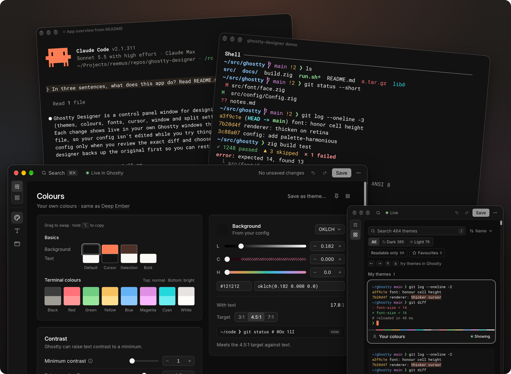

# ghostty-designer

[](https://github.com/reemus-dev/ghostty-designer/actions/workflows/ci.yml)
[](https://github.com/reemus-dev/ghostty-designer/releases/latest)

**A visual editor for Ghostty, with every change previewed live in your running
terminals.**

Themes, colours, fonts, cursor and window. Nothing is saved until you review the
diff.



▶ [Watch the 1-minute video](https://www.youtube.com/watch?v=tcUtw31Ih2Y)

- **Themes:** try themes with the arrow keys, or pin a theme beside your colours
  and copy single colours from it.
- **Colours:** tune each colour with OKLCH sliders and contrast checks.
- **Fonts:** browse fonts previewed in their own typeface, with ligature,
  feature and variable-axis controls.
- **Cursor and window:** set cursor, opacity, blur, padding, titlebar and split
  options.
- **Other apps:** edit the config of apps built on libghostty, such as cmux.
- **Safe saves:** save only the lines you changed, with a backup first.

<!-- oxfmt-ignore -->
> [!NOTE]
> **Built entirely by AI agents in Claude Code with Opus 5.5 💌**
>
> I own the result, and I put my expertise and care into it.

An unofficial community tool, not affiliated with the Ghostty project.

## Install

The designer installs as a terminal command, `ghostty-designer`. Run it in a
terminal to open the panel window.

| Requirement | Needs                                                                     |
| ----------- | ------------------------------------------------------------------------- |
| Ghostty     | [Installed](https://ghostty.org/download), 1.3.1 or later                 |
| macOS       | 15 or later, arm64 or x86_64                                              |
| Linux       | glibc 2.34 or later (Ubuntu 22.04, Debian 12, Fedora 35), arm64 or x86_64 |

**Homebrew** (macOS)

```sh
brew install reemus-dev/tap/ghostty-designer
```

**Linux packages**

Download the `.deb` or `.rpm` for your platform from
[GitHub Releases](https://github.com/reemus-dev/ghostty-designer/releases). The
packages install the runtime libraries.

```sh
sudo apt install ./ghostty-designer_<version>_amd64.deb      # Ubuntu, Debian
sudo dnf install ./ghostty-designer-<version>-1.x86_64.rpm   # Fedora
```

**Mise** (macOS, Linux)

```sh
mise use -g github:reemus-dev/ghostty-designer
```

**npm** (macOS, Linux)

Run it without installing:

```sh
npx ghostty-designer@latest     # or: bunx ghostty-designer@latest
```

Or install it:

```sh
npm install -g ghostty-designer
```

On Linux, Mise, npm and the release tarball need the runtime libraries:

<details>
<summary>Runtime libraries</summary>

```sh
sudo apt install libwebkit2gtk-4.1-0 libgtk-3-0 procps fontconfig   # Ubuntu, Debian
sudo dnf install webkit2gtk4.1 gtk3 procps-ng fontconfig             # Fedora
sudo pacman -S --needed webkit2gtk-4.1 gtk3 procps-ng fontconfig     # Arch
```

To use the tarball from the release, copy `ghostty-designer` from it to a
directory on `PATH`.

</details>

<details>
<summary>Build from source</summary>

Requires [Mise](https://mise.jdx.dev/). On Linux, the build also needs the GTK 3
and WebKitGTK 4.1 development packages (`libwebkit2gtk-4.1-dev` on Debian and
Ubuntu).

```sh
git clone https://github.com/reemus-dev/ghostty-designer.git
cd ghostty-designer
mise install
mise run install
mise run build
./dist/ghostty-designer
```

</details>

## Quick start

<!-- oxfmt-ignore -->
> [!NOTE]
> The designer is a GUI app, but you launch it from a terminal.

1. Run `ghostty-designer`. The panel opens in its own window, and the prompt
   returns.
2. Click **Enable live preview**. The designer backs up your config, then adds
   two lines to the end of it.
3. Change a setting and watch Ghostty update. Some settings apply only to new
   windows, and the panel notes which.
4. Click **Save to config…**, review the exact changes, and confirm.

The panel has two views. **Customise** shows your colours, font and window
settings on one page. **Themes** shows every theme as a small terminal in its
colours.

Click **Live in Ghostty** in the toolbar to turn the live preview off or on. The
designer remembers your choice. Close the panel to stop the designer. With
unsaved changes, it asks first.

## How your config stays safe

```text
 Panel
   │
   ├─ every change ─▶ ghostty-designer.conf
   │                  (emptied when the designer stops)
   │                        │ included after your config
   │                        ▼
   │                  Ghostty reloads
   │
   └─ Save ─▶ review the exact diff
                    │ confirm
                    ▼
              your config: changed lines only
              (backed up first)
```

**Preview never edits your config.** Each change goes to
`ghostty-designer.conf`, next to your config, and Ghostty reloads. The preview
loads after every line of your main config file, so it wins over all of them. A
file that loads later can still override it, such as a file that one of your
includes includes. The panel warns when that hides a change.

**Save edits only what you changed, where it is set.** The save rewrites each
changed key on the line that sets it last, even in an included file. It adds new
keys in a `# ghostty-designer: saved settings` block. Comments, order and
formatting stay. When you save a new theme, the save comments out your colour
lines that would override it with `# ghostty-designer:`. The review lists those
lines, and any settings in the theme besides colours.

**Undo any write:**

| Write                                               | Undo                                                         |
| --------------------------------------------------- | ------------------------------------------------------------ |
| `ghostty-designer.conf`, on each change             | Stop the designer, or delete the file                        |
| Two include lines, on **Enable live preview**       | Delete the two lines                                         |
| Changed lines in your config, on save               | Copy back the file from `previous/`, or restore the original |
| A theme file in `~/.config/ghostty/themes`, on save | Delete the file. A theme never replaces another file.        |

Before it changes a config file, the designer backs the file up to
`~/.local/state/ghostty-designer/` (`$XDG_STATE_HOME/ghostty-designer/` when
set):

- `original/` keeps each file as it was before the designer first changed it,
  and is never replaced.
- `previous/` keeps each file as it was before the latest save.

**Restore original config…** in the ⋯ menu puts back the current config's files
from `original/`. It also discards every later change to those files, including
your own edits.

**Other guarantees:**

- The panel's controls edit only appearance settings: colours, fonts, cursor,
  window and splits. A theme can carry other settings, and the save review lists
  them.
- Ghostty validates every preview before it loads. The designer leaves out a
  value Ghostty rejects, and the panel names that setting.
- A save stops before it writes anything if a config file changed on disk after
  your review.
- If a file cannot be written, the save puts back the files it already wrote. It
  never rewrites a file that is not valid UTF-8.
- Quitting, a termination signal or a designer crash empties the preview file.
  After a hard kill or power loss, Ghostty shows the last preview until the
  designer starts again or you delete the file. The include is optional
  (`config-file = ?ghostty-designer.conf`), so Ghostty starts without the file.

## Usage

### Command line

| Command                          | Action                                                                              |
| -------------------------------- | ----------------------------------------------------------------------------------- |
| `ghostty-designer`               | Open the panel, or bring the open panel to the front                                |
| `ghostty-designer --config FILE` | Edit `FILE` instead of Ghostty's config. A running designer offers to switch to it. |
| `ghostty-designer demo`          | Print sample output in this terminal's colours and font                             |

### Shortcuts

| macOS      | Linux                 | Action                                          |
| ---------- | --------------------- | ----------------------------------------------- |
| ⌘K         | Ctrl+K                | Find any setting, theme, font or action         |
| ⌘S         | Ctrl+S                | Review and save                                 |
| ⌘Z / ⇧⌘Z   | Ctrl+Z / Ctrl+Shift+Z | Undo / redo                                     |
| ⌥1 / ⌥2    | Alt+1 / Alt+2         | Show Customise / Themes                         |
| `/`        | `/`                   | Search fonts in Customise, or themes in Themes  |
| Hold `\`   | Hold `\`              | Show your saved config in Ghostty while held    |
| Arrow keys | Arrow keys            | In the theme grid or font list, try each choice |

Trying several themes or fonts in a row is one undo step.

### Other apps' configs

Apps built on libghostty can load a config file of their own. To edit one,
choose **Switch config…** in the toolbar's ⋯ menu or with ⌘K. The designer still
needs Ghostty installed. The switcher lists the apps below when their config
file has content, your recent files, and any other file by path.

| App      | Config file                                                     | Loads Ghostty's config first |
| -------- | --------------------------------------------------------------- | ---------------------------- |
| cmux     | `~/Library/Application Support/com.cmuxterm.app/config.ghostty` | Yes                          |
| Supacode | `~/.config/supacode/config.ghostty`                             | Yes                          |
| Ghostex  | `~/.config/ghostex/ghostty/config.ghostty`                      | No                           |
| agterm   | `~/.config/agterm/ghostty.conf`                                 | No                           |
| macterm  | `~/.config/macterm/config.ghostty`                              | Yes                          |

The designer loads any other file on top of Ghostty's config. To change this for
a file, select it in the switcher and change **Does this app use Ghostty's
config as a base?**.

- A save writes only that file and the files it includes. When a line in
  Ghostty's config still decides a setting, the save review says so.
- The live preview reloads only Ghostty. Other apps show your changes when they
  reload their config.
- When you edit Ghostty's config, the save review names the settings that an
  app's own config overrides.

The designer opens the config you last edited.

## Troubleshooting

<!-- [UNTIL] The oldest Ghostty the designer supports includes the fix. https://github.com/ghostty-org/ghostty/issues/14833 Then remove the colour-query item. -->

- **A change does not show in Ghostty.** A file that loads after the preview may
  set the same key, and the panel warns about it. Check the order of your
  `config-file` lines.
- **A cursor change does not show.** Ghostty draws a hollow block in windows
  that are not focused. Click into Ghostty.
- **The cursor turns into a bar at the prompt.** Shell integration sets it. Turn
  on **Use this cursor at the shell prompt**.
- **Background opacity does not change on macOS.** Open a new Ghostty window, or
  restart Ghostty.
- **macOS asks to let the designer control Ghostty.** A font size change resets
  each window's zoom (⌘+ / ⌘−) through Apple Events. Allow it, so zoomed windows
  show the new size.
- **Colours or fonts differ from another app.** Check whether the app loads
  Ghostty's config first, then set **Does this app use Ghostty's config as a
  base?** to match in the config switcher.
- **A program keeps its old colours while the designer runs.** The preview turns
  off Ghostty's replies to colour queries (`osc-color-report-format = none`),
  because Ghostty 1.3.1 can freeze when a reload lands during a burst of them.
  Ghostty 1.4.0 has the
  [fix](https://github.com/ghostty-org/ghostty/pull/14834), and the designer
  keeps the workaround while it supports 1.3.1.
- **`error while loading shared libraries: libwebkit2gtk-4.1.so.0`.** Install
  the [runtime libraries](#install).
- **Anything else.** Startup errors print in the terminal. Later output goes to
  `~/.local/state/ghostty-designer/ghostty-designer.log`.

## Uninstall

1. Quit the designer.
2. In each config where you enabled live preview, delete these two lines, and
   delete `ghostty-designer.conf` next to it:

   ```text
   # ghostty-designer: live preview, keep below other config-file lines
   config-file = ?ghostty-designer.conf
   ```

3. Remove the package with the tool that installed it.
4. Optional: delete `~/.local/state/ghostty-designer/` once you no longer need
   its backups.

Your saved settings and themes are ordinary Ghostty config and stay.

## Contributing

See [CONTRIBUTING.md](CONTRIBUTING.md).
[docs/architecture.md](docs/architecture.md) describes how the work splits
between the Rust host and the panel.

## License

[MIT](LICENSE)
