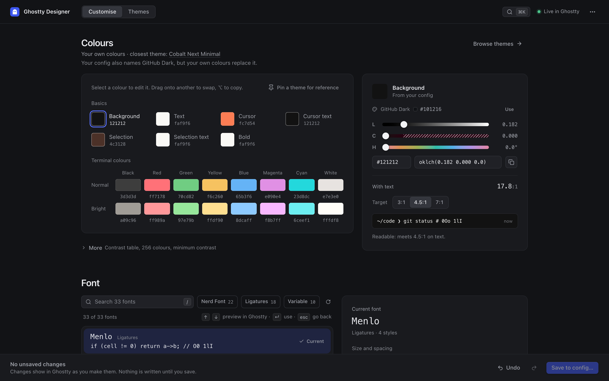

# ghostty-designer

[](https://github.com/reemus-dev/ghostty-designer/actions/workflows/ci.yml)
[](https://github.com/reemus-dev/ghostty-designer/releases/latest)



Design Ghostty's appearance in a control panel window, with your own Ghostty
windows as the live preview. An unofficial community tool, not affiliated with
the Ghostty project.

- Try any of Ghostty's themes, or tune your own colours with OKLCH sliders and
  readability checks
- Pin a theme beside your colours and copy the ones you like
- Pick fonts drawn in their own face, with ligature, feature and variable-axis
  controls
- Set cursor, opacity, blur, padding, titlebar and split options
- See every change in Ghostty at once, and save to your config only when you
  choose

## Contents

- [Installation](#installation)
- [Usage](#usage)
- [How your config stays safe](#how-your-config-stays-safe)
- [Development](#development)
- [License](#license)

## Installation

<!-- oxfmt-ignore -->
> [!NOTE]
> `ghostty-designer` runs on macOS and Linux, on arm64 and x86_64. It is tested with Ghostty 1.3.1.

On Linux it needs glibc 2.34 or later (Ubuntu 22.04, Debian 12, Fedora 35), GTK
3 and WebKitGTK 4.1. The `.deb` and `.rpm` packages install them.

### Homebrew

```sh
brew install reemus-dev/tap/ghostty-designer
```

### Mise

```sh
mise use -g github:reemus-dev/ghostty-designer
```

### Linux packages

Download the `.deb` or `.rpm` for your platform from the
[GitHub Releases](https://github.com/reemus-dev/ghostty-designer/releases) page:

```sh
sudo apt install ./ghostty-designer_<version>_amd64.deb      # Ubuntu, Debian
sudo dnf install ./ghostty-designer-<version>-1.x86_64.rpm   # Fedora
```

The release also has a tarball for each platform. Copy `ghostty-designer` from
it to a directory on `PATH`, after you install the runtime libraries:

```sh
sudo apt install libwebkit2gtk-4.1-0 libgtk-3-0 procps fontconfig   # Ubuntu, Debian
sudo dnf install webkit2gtk4.1 gtk3 procps-ng fontconfig             # Fedora
sudo pacman -S --needed webkit2gtk-4.1 gtk3 procps-ng fontconfig     # Arch
```

### From source

Requires [Mise](https://mise.jdx.dev/).

```sh
git clone https://github.com/reemus-dev/ghostty-designer.git
cd ghostty-designer
mise install
mise run install
mise run build
```

The binary is written to `dist/ghostty-designer`. On Linux, the build needs the
GTK 3 and WebKitGTK 4.1 development packages (`libwebkit2gtk-4.1-dev` on Debian
and Ubuntu).

## Usage

```sh
ghostty-designer            # open the control panel window
ghostty-designer specimen   # print a colour and font specimen in this terminal
```

From a terminal, the designer moves to the background, and the prompt returns
once the window is open. Startup errors print in the terminal. Later output goes
to `~/.local/state/ghostty-designer/ghostty-designer.log`.

The panel opens on **Customise**, which shows your current colours, font and
window settings on one page. **Themes** lists every theme as a small terminal in
its colours. Click a theme or a font, or move to it with the arrow keys, and
Ghostty shows it. ⌘Z after trying several goes back to where you started in one
step. Press ⌘K to find any setting.

On first run, the panel asks to add an include line to the end of your config,
which turns on the live preview. From then on every change shows in your Ghostty
windows as you make it. Nothing else is written until you choose **Save to
config…**, review the exact changes and confirm. Click the live status in the
toolbar to turn the live preview off or on. The designer remembers your choice.

Running `ghostty-designer` again while it runs brings its window to the front.

Closing the panel window or quitting the app stops the designer. With unsaved
changes, the panel asks first.

- **Font size:** a change resets each window's zoom (⌘+ / ⌘−) to the new size.
  On macOS, the first one asks for permission to control Ghostty, which is how
  the zoom is reset.
- **Cursor:** Ghostty draws a hollow block in windows that are not focused, so
  click into Ghostty to see a cursor change. Shell integration sets a bar cursor
  at every prompt unless you turn on **Use this cursor at the shell prompt**.

## How your config stays safe

```text
 Control panel window
        │ every change
        ▼
 ghostty-designer ── appearance settings only, checked by ghostty +validate-config
        │
        ├─ preview ─▶ ghostty-designer.conf, next to your config ──┐ included by
        │             emptied when the designer stops               │ your config,
        │                                                            ▼ loaded last
        │                                            Ghostty reloads every window
        │
        └─ Save  (only after you review the exact diff)
                 ├─▶ ~/.local/state/ghostty-designer/original/  first copy, never replaced
                 ├─▶ ~/.local/state/ghostty-designer/previous/  copy before the latest write
                 └─▶ your config   only the changed lines, edited in place
```

Your config over time:

```text
 ──●───────────────────●───────────────────────────●──────────────▶
   designer starts     Enable live preview         Save
   nothing written     2 lines added at the end    your changed lines
                       (original copied first)     (previous version copied first)

   ⋯ › Restore original config…  puts the file back as it was at the first ●
```

**Previewing never edits your config.** Each change goes to the preview file,
then Ghostty reloads. Ghostty loads an included file after the whole file that
includes it, so the preview wins over every line of your config, even lines
below the include. Only a `config-file` line placed after it loads later, and
the panel warns when that hides a change.

- Ghostty checks every preview before loading it. A value it rejects is left
  out, and the panel names that setting.
- While the designer runs, the preview file also turns off Ghostty's replies to
  colour queries (`osc-color-report-format = none`). Ghostty 1.3.1 can freeze
  when a reload lands while a program floods it with colour queries, as Herdr
  does after every reload. Programs that ask for Ghostty's colours meanwhile
  keep the colours they knew.
- Stopping the designer clears the preview file: closing the panel, quitting the
  app, a termination signal, or a crash. After a hard kill or power loss,
  Ghostty shows the last preview until the next start replaces it, or until you
  delete the file. The `?` makes the include optional, so Ghostty starts fine
  without the file.
- The panel can only change appearance keys: colours, fonts, cursor, window and
  splits. Keybinds, commands and every other key are out of its reach.

**Saving edits only what you changed, where it is defined.**

- A changed key is rewritten on the line that sets it last, even inside an
  included file. Keys your config does not set yet go into a
  `# ghostty-designer: saved settings` block. Comments, order and formatting
  stay.
- A new theme would be hidden by your explicit colour lines and wiped by a
  `palette = ""` reset, so save comments them out with `# ghostty-designer:`
  instead of deleting them. The save sheet lists them, and any setting besides
  colours in the theme file, which Ghostty applies too.
- If any config file changes on disk after you review the save, the save stops
  before writing anything.
- A save writes every file or none: if one file cannot be written, the files
  written before it are put back. A file that is not valid UTF-8 is never
  rewritten.

**Every write can be undone.**

| What                                       | When                                                                    | Undo                                                  |
| ------------------------------------------ | ----------------------------------------------------------------------- | ----------------------------------------------------- |
| The preview file                           | On start, and on every change while live preview is on                  | Stop the designer, or delete the file                 |
| Two lines at the end of your config        | When you click **Enable live preview**                                  | **Restore original config…**, or delete the two lines |
| The changed lines in your config           | When you confirm **Save**                                               | **Restore original config…**, or the previous copy    |
| A theme file in `~/.config/ghostty/themes` | When you save colours as a theme, or tick the backup option when saving | Delete the file. A theme never replaces another file. |

Before its first write to a file, the designer copies the file to
`~/.local/state/ghostty-designer/original/`, and never overwrites that copy.
**Restore original config…** in the ⋯ menu puts every file back as it was before
the designer first touched it. Each completed write also keeps the files it
changed, as they were before it, in `~/.local/state/ghostty-designer/previous/`,
replacing the copy from the write before.

## Development

Requires [Mise](https://mise.jdx.dev/).

```sh
mise install
mise run install
mise run check
```

`mise run dev` runs the app from source against your real config and reloads
your Ghostty. To work without touching either, use a sandbox with its own home
and config under `.cache/sandboxes/`. In a shell with mise activated, the
commands in `scripts/` are on the PATH:

```sh
sandbox.ts --name try run         # the app from source in the sandbox "try"
sandbox.ts --name try run --dev   # the same, with a hot-reloading UI
sandbox.ts --name try reset       # restore the sandbox's baseline config
sandbox.ts --name try start       # run in the background, until "stop"
```

Each name is a separate sandbox, so runs with different names can run side by
side.

A sandboxed app never reloads Ghostty, so previews land only in the sandbox's
config files.

Development builds, from `mise run dev` and sandboxes, serve WebDriver on
127.0.0.1, so `panel.ts` can drive the panel. `docs/verify.md` describes it.

`mise run test:scenarios` replays the session scenarios against an installed
Ghostty 1.3.1.

## License

[MIT](LICENSE)
